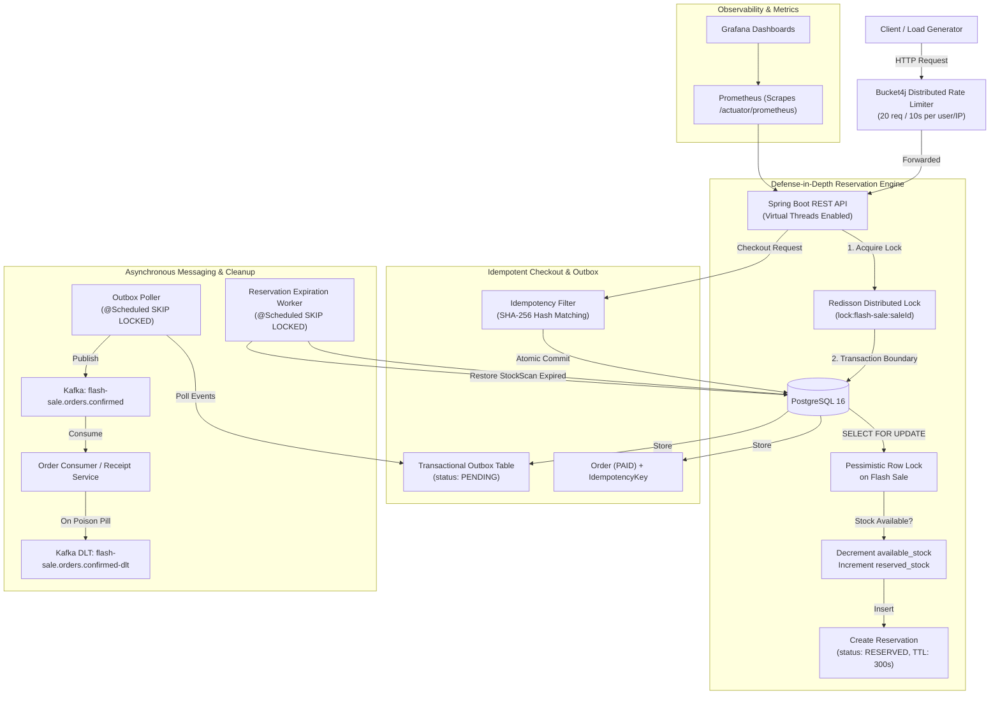

# Event-Driven Flash Sale & Inventory Reservation Engine

[](https://openjdk.org/projects/jdk/21/)
[](https://spring.io/projects/spring-boot)
[](https://www.postgresql.org/)
[](https://redis.io/)
[](https://kafka.apache.org/)
[](LICENSE)

A production-grade, high-throughput **Event-Driven Flash Sale and Inventory Reservation Engine** designed to handle extreme burst traffic (2,000+ concurrent requests competing for 100 units) with **zero-oversell guarantees**, deterministic low latency, expiring reservations, idempotent checkouts, and transactional event publishing.

---

## 🏛 Architecture Overview



---

## 🚀 Key Architectural Features

- **Defense-in-Depth Concurrency:** Dual-layer synchronization using **Redisson Distributed Locks** (funneling traffic at the network edge) backed by **PostgreSQL Pessimistic Locking (`SELECT FOR UPDATE`)** as the ultimate consistency anchor.
- **Strict Zero-Oversell:** Database-level check constraints (`CONSTRAINT chk_stock_balance CHECK (available_stock + reserved_stock <= total_stock)`) guarantee physical invariants are never breached.
- **Idempotent Checkout:** Cryptographic SHA-256 payload verification with database unique constraints prevents double-charging during client retries or network replays.
- **Transactional Outbox Pattern:** Decoupled Kafka publishing with zero dual-write vulnerabilities. Background pollers utilize `FOR UPDATE SKIP LOCKED` for scale-out parallel polling.
- **Dead Letter Topic (DLT) & Retries:** Kafka consumers leverage `@RetryableTopic` with exponential backoff (1s, 2s) and structured DLT routing for poison pills.
- **Distributed Rate Limiting:** Token-bucket rate limiting (20 requests per 10 seconds) enforced via Bucket4j backed by Lettuce and Redis.
- **Java 21 Virtual Threads:** High throughput I/O multiplexing enabled with `spring.threads.virtual.enabled=true`.
- **Full Observability:** Out-of-the-box Prometheus metrics and pre-provisioned Grafana dashboards.

---

## 📋 Technology Stack

| Layer | Component | Version / Implementation |
| :--- | :--- | :--- |
| **Runtime** | Java | OpenJDK 21 (Virtual Threads Enabled) |
| **Framework** | Spring Boot | 3.4.5 |
| **Database** | PostgreSQL | 16 (Flyway Migrations) |
| **Cache & Lock** | Redis & Redisson | Redis 7 + Redisson 3.45.1 |
| **Rate Limiter** | Bucket4j | 8.14.0 (Lettuce Distributed Driver) |
| **Messaging** | Apache Kafka | 3.8.0 (KRaft Mode, No Zookeeper) |
| **Metrics** | Micrometer | Prometheus Registry |
| **Monitoring** | Grafana | 10.x with Pre-provisioned Dashboards |
| **Testing** | Testcontainers | PostgreSQL, Redis, Kafka Containers |
| **Load Testing** | k6 | High-concurrency Spike Scenarios |

---

## ⚡ Quickstart: Single-Command Setup

### Prerequisites
- Docker Engine & Docker Compose installed
- JDK 21 (optional for local builds; Maven wrapper included)

### 1. Launch the Full Stack
```bash
docker compose up --build
```

The stack initializes the following services:
- **Application:** `http://localhost:8080`
- **PostgreSQL 16:** `localhost:5432` (db: `flashsale`, user: `postgres`, pass: `postgres`)
- **Redis 7:** `localhost:6379`
- **Kafka 3.8.0:** `localhost:9092`
- **Prometheus:** `http://localhost:9090`
- **Grafana:** `http://localhost:3000` (Anonymous Admin access enabled)

---

## 🛠 End-to-End API Walkthrough

The application boots with a pre-seeded product (`SNEAKER-LTD-001`) and an active flash sale (`11111111-1111-1111-1111-111111111111`).

### Step 1: Query Flash Sale State
```bash
curl -i -X GET http://localhost:8080/api/v1/flash-sales/11111111-1111-1111-1111-111111111111
```
**Response (`200 OK`):**
```json
{
  "id": "11111111-1111-1111-1111-111111111111",
  "productName": "Limited Edition Cyber Sneakers",
  "sku": "SNEAKER-LTD-001",
  "priceCents": 25000,
  "totalStock": 100,
  "availableStock": 100,
  "reservedStock": 0,
  "maxPerUser": 2,
  "startsAt": "2026-11-19T03:00:00Z",
  "endsAt": "2026-11-20T04:00:00Z",
  "status": "ACTIVE"
}
```

### Step 2: Reserve Inventory
```bash
curl -i -X POST http://localhost:8080/api/v1/flash-sales/11111111-1111-1111-1111-111111111111/reservations \
  -H "Content-Type: application/json" \
  -H "X-User-Id: buyer-42" \
  -d '{"quantity": 1}'
```
**Response (`201 Created`):**
```json
{
  "reservationId": "a92e10cb-8f19-4b36-a320-b44e7eef4118",
  "flashSaleId": "11111111-1111-1111-1111-111111111111",
  "userId": "buyer-42",
  "quantity": 1,
  "status": "RESERVED",
  "expiresAt": "2026-11-19T04:15:00Z"
}
```

### Step 3: Checkout with Idempotency Key
```bash
curl -i -X POST http://localhost:8080/api/v1/orders \
  -H "Content-Type: application/json" \
  -H "X-User-Id: buyer-42" \
  -H "Idempotency-Key: idemp-req-9999" \
  -d '{
    "reservationId": "a92e10cb-8f19-4b36-a320-b44e7eef4118",
    "paymentToken": "tok_valid_visa_4242"
  }'
```
**Response (`201 Created`):**
```json
{
  "orderId": "65b868e4-8a56-4c45-9271-e408ec9cf789",
  "reservationId": "a92e10cb-8f19-4b36-a320-b44e7eef4118",
  "userId": "buyer-42",
  "totalAmountCents": 25000,
  "status": "PAID",
  "paymentReference": "pay_b23f2f0c-b26a-4ee1-b755-e4142f1cf5ec",
  "createdAt": "2026-11-19T04:10:30Z"
}
```

### Step 4: Duplicate Idempotent Retry
Repeat the exact same checkout command:
```bash
curl -i -X POST http://localhost:8080/api/v1/orders \
  -H "Content-Type: application/json" \
  -H "X-User-Id: buyer-42" \
  -H "Idempotency-Key: idemp-req-9999" \
  -d '{
    "reservationId": "a92e10cb-8f19-4b36-a320-b44e7eef4118",
    "paymentToken": "tok_valid_visa_4242"
  }'
```
**Response (`201 Created` with replay header):**
```http
HTTP/1.1 201 Created
X-Idempotent-Replayed: true
Content-Type: application/json
...
```
*(Returns identical order details without creating duplicate orders or duplicate outbox events).*

---

## 🧪 Testing & Verification

### Running Automated Integration Tests
The test suite utilizes **Testcontainers** to verify concurrency and fault scenarios against real PostgreSQL 16, Redis 7, and Kafka KRaft instances:

```bash
# Windows
.\mvnw.cmd test

# Linux / macOS
./mvnw test
```

Key integration tests include:
- `ConcurrencyOversellIntegrationTest`: Spawns **200 concurrent virtual threads** contending for 50 stock units. Asserts exactly 50 succeed (`201`), exactly 150 reject (`409`), and remaining stock is 0.
- `IdempotencyIntegrationTest`: Fires 10 concurrent racing requests with the same idempotency key; verifies exactly 1 database order and 1 outbox event are recorded.
- `ReservationExpirationIntegrationTest`: Verifies that expired reservations are detected by the background worker and inventory is returned to the available pool.
- `RateLimitIntegrationTest`: Verifies token-bucket rate limiter rejection (`429 Too Many Requests`).

### Running k6 Load Tests
With the Docker Compose stack running, execute the burst spike test (500 virtual users executing 2,000 iterations):

```bash
# Using installed k6
k6 run load-tests/flash-sale-spike.js

# Or using Docker
docker run --rm -i --network=host grafana/k6 run - <load-tests/flash-sale-spike.js
```

---

## 📊 Observability & Metrics

Access Grafana at [http://localhost:3000](http://localhost:3000). The dashboard (**Flash Sale Engine Overview**) monitors:
- **HTTP Request Rate & p95/p99 Latency**
- **JVM Live Platform Threads & HikariCP Connection Usage**
- **Custom Business Metrics:**
  - `flashsale_reservations_created_total`
  - `flashsale_reservations_expired_total`
  - `flashsale_orders_confirmed_total`
  - `flashsale_kafka_dlt_messages_total`

Prometheus metrics endpoint: [http://localhost:8080/actuator/prometheus](http://localhost:8080/actuator/prometheus)

---

## 📖 Architecture Decision Record (ADR)
For an in-depth breakdown of locking trade-offs, transactional outbox semantics, and distributed failure mode analysis, read:
- [ADR-001: Concurrency Strategy & Event-Driven Architecture](docs/ADR-001-concurrency-strategy.md)
